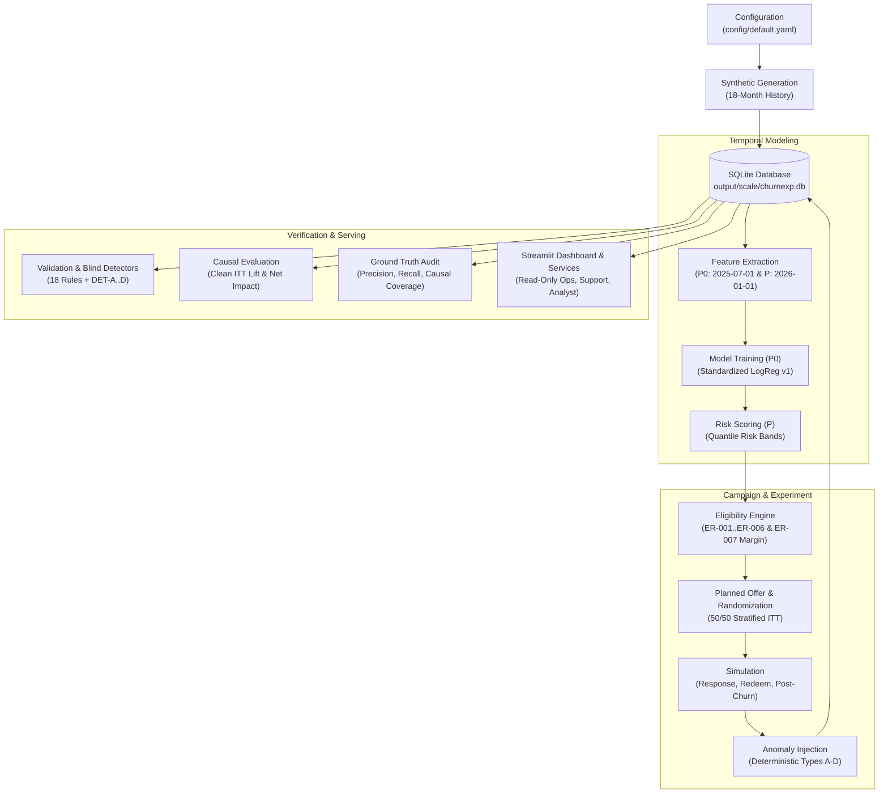

# Churn Detection and Retention Offer Experiment

An end-to-end, reproducible, and scientifically rigorous framework to detect customer churn risk using strictly pre-prediction behavioural signals, enforce multi-stage eligibility and margin guardrails, run a randomized 50/50 retention offer experiment with withheld controls, and estimate causal Intention-to-Treat (ITT) lift and integer-cent financial return on investment.

---

## 1. Quick Start (60 Seconds)

Compatible with macOS and modern Linux distributions using Python 3.11.

### Prerequisites
Ensure Python 3.11 is installed:
- **macOS (Homebrew)**: `brew install python@3.11`
- **Debian / Ubuntu**: `sudo apt install python3.11 python3.11-venv`

### Setup and Interactive Demo
```bash
# 1. Setup virtual environment and install dependencies
make setup

# 2. Run the end-to-end starter pipeline and launch the Streamlit actor dashboard
make demo
```

The Streamlit dashboard opens automatically at `http://localhost:8501`.

---

## 2. Command Reference

All system operations are orchestrated via `python -m churnexp` or top-level `make` targets:

| Command | Subcommand / Target | Purpose & Output Description |
| :--- | :--- | :--- |
| `make setup` | `setup` | Creates `.venv` with Python 3.11, upgrades pip, and installs `requirements.txt` + editable package. |
| `make test` | `test` | Executes full automated test suite (123 unit tests) via pytest. |
| `make qa` | `qa` | Runs `scripts/make_test_report.py`, producing `docs/TEST_REPORT.md` with operational checks. |
| `make demo` | `demo` | Executes `all --scale starter` and launches interactive Streamlit dashboard. |
| `make app` | `app` | Starts Streamlit actor dashboard directly on existing database artifacts. |
| `make health` | `health --scale [starter\|full]` | Verifies Python 3.11 runtime, seed configuration, package version, and SQLite3 driver. |
| `make full` | `all --scale full` | Executes complete end-to-end pipeline at full 20,000-subscriber scale. |
| `python -m churnexp config` | `config --scale [starter\|full]` | Prints fully resolved YAML configuration parameters to stdout. |
| `python -m churnexp generate` | `generate --scale [starter\|full]` | Generates synthetic history, features, ML models, campaign assignments, and anomalies into SQLite. |
| `python -m churnexp export` | `export --scale [starter\|full]` | Exports SQLite database tables to CSV, JSON, and SQL seed dumps, generating `MANIFEST.json`. |
| `python -m churnexp validate` | `validate --scale [starter\|full]` | Runs 18 structural, temporal, and reconciliation checks plus blind business-rule detectors. |
| `python -m churnexp evaluate` | `evaluate --scale [starter\|full]` | Evaluates clean-cohort model AUC, ITT causal lift (90d/180d), and integer-cent net impact. |
| `python -m churnexp audit` | `audit --scale [starter\|full]` | Audits blind detector precision/recall and estimator confidence interval against hidden ground truth. |
| `python -m churnexp repro-check`| `repro-check --scale [starter\|full]`| Runs two independent generation/export cycles (`PYTHONHASHSEED=1` vs `2`) to verify bitwise reproducibility. |
| `python -m churnexp all` | `all --scale [starter\|full]` | Sequentially executes `generate`, `export`, `validate`, `evaluate`, and `audit`. |

---

## 3. Storage Footprint & Committed Data Policy

Outputs are strictly segregated into committed public data, reproducible outputs, and hidden ground truth:

```
churn-retention-experiment/
├── output/                      # Ignored in Git; local working SQLite databases
│   ├── starter/churnexp.db      # 1,000 subscribers (~13 MB)
│   └── full/churnexp.db         # 20,000 subscribers (~263 MB)
└── data/                        # Public exports and evaluation artifacts
    ├── starter/                 # COMMITTED IN GIT (all formats)
    │   ├── csv/                 # 15 relational tables in CSV (~1.8 MB)
    │   ├── json/                # 15 relational tables in JSON (~6.8 MB)
    │   ├── sql/seed.sql         # Plain SQL relational insert script (~2.6 MB)
    │   ├── ground_truth/        # Latent state, anomalies, expected decisions
    │   ├── MANIFEST.json        # Cryptographic SHA-256 hashes & row counts
    │   ├── REPRODUCIBILITY.md   # Subprocess bitwise verification certificate
    │   ├── evaluation_results.json & evaluation_report.md
    │   └── anomaly_report.json & audit_report.json
    └── full/                    # COMMITTED ONLY AS REPORTS & MANIFESTS
        ├── MANIFEST.json        # Verifies 20k dataset hashes without committing raw tables
        ├── REPRODUCIBILITY.md   # Bitwise reproducibility certificate for 20k rows
        ├── evaluation_results.json & evaluation_report.md
        └── anomaly_report.json & audit_report.json
```

### Why Full CSV is Not Committed
At 20,000 customers, the raw CSV export totals ~108 MB (and JSON totals ~450 MB). To keep the Git repository lightweight, fast to clone, and strictly within version control best practices:
- The **starter scale (1,000 customers)** is fully committed across all formats (CSV, JSON, SQL, ground truth) for immediate inspection.
- The **full scale (20,000 customers)** is verified deterministically in seconds via `MANIFEST.json` containing SHA-256 cryptographic hashes for every file.

---

## 4. Architecture & Pipeline Design

The system is built as a single modular Python package `churnexp`:



### Package Module Overview

| Package / Directory | Primary Responsibility | Key ADR |
| :--- | :--- | :--- |
| `src/churnexp/generation/` | Synthetic customer history, subscriptions, usage, billing, and support cases | ADR-001, ADR-008 |
| `src/churnexp/schema/` | Plain SQLite SQL DDL schema, foreign keys, CHECK constraints, and views | ADR-002, ADR-003 |
| `src/churnexp/features/` | Temporal point-in-time snapshot feature engineering ($P_0$ and $P$) | ADR-004 |
| `src/churnexp/modeling/` | Out-of-time logistic regression training, scoring, and risk bands | ADR-010, ADR-012 |
| `src/churnexp/eligibility/` | Rules ER-001 through ER-007, margin cap guardrails, and catalog | ADR-007, ER-007 |
| `src/churnexp/experiment/` | Planned offer assignment, stratified randomization, and outcome simulation | ADR-005, ADR-007 |
| `src/churnexp/anomalies/` | Deterministic injection of operational defect types A-D at pipeline tail | ADR-013 |
| `src/churnexp/validation/` | 18 structural validation checks and 4 blind business-rule detectors | ADR-002, ADR-014 |
| `src/churnexp/audit/` | Independent comparison of detector findings against isolated ground truth | ADR-006, ADR-015 |
| `src/churnexp/evaluation/` | Clean-cohort ITT causal lift, analytical 95% CIs, and integer-cent financials | ADR-012, ADR-016 |
| `src/churnexp/services/` | Strictly read-only domain queries powering UI and reporting layers | ADR-011 |
| `app/streamlit_app.py` | Actor-specific interactive web dashboard (Ops, Support, Analyst, Admin) | ADR-011 |

---

## 5. Temporal Design & Leakage Defenses (ADR-004)

```
Jan 2025              Jul 2025                       Dec 2025       Jan 2026                      Jun 2026
   |---------------------|------------------------------|--------------|-----------------------------|
   |<- 6m Train Lookback |<- 180d Train Churn Horizon ->|              |                             |
   |                     P0: 2025-07-01 (Train Cutoff)  |              |                             |
   |                                                                   P: 2026-01-01 (Score Cutoff)  |
   |                                                    <- 6m Lookback |<- 180d Score Churn Horizon->|
   |                                                                   |<- 90d Retention Window ---->|
```

1. **Dual Snapshot Chronology**:
   - **Training Snapshot $P_0 = 2025-07-01$**: Features look strictly backwards across $[2025-01-01, 2025-06-30]$. Churn labels evaluate the subsequent 180 days ($[2025-07-01, 2025-12-28]$). All training labels are fully resolved before scoring date $P$.
   - **Scoring Snapshot $P = 2026-01-01$**: Features look strictly backwards across $[2025-07-01, 2025-12-31]$. The model trained at $P_0$ is frozen and scores accounts at $P$.
2. **Point-in-Time Integrity Rule**: An event record is eligible for feature extraction if and only if $\text{event\_date} < \text{as\_of\_date}$, and monthly snapshots count if and only if $\text{period\_end} < \text{as\_of\_date}$.
3. **Mutate-the-Future Verification**: Automated tests (`test_mutate_the_future_leakage_defense`) inject corrupt future events post-$P$ and verify that extracted feature matrices remain bitwise identical.

---

## 6. Experimentation Design & Causal Validity (ADR-007)

1. **Planned Offer Selection First**:
   Before randomization, candidate offers passing the margin guardrail (Rule ER-007) are identified. For each eligible customer, one offer is selected as their **planned offer**.
2. **Stratified 50/50 Randomization**:
   Accounts are randomized 50/50 into `TREATMENT` or `CONTROL`, stratified across `(risk_band, plan_tier, segment)`.
3. **Withheld Control Contacts**:
   Control subjects receive a `campaign_contact` row with `contact_status = 'WITHHELD'`, recording their planned `offer_id`. This prevents selection bias and enables unbiased offer-level lift comparisons.
4. **Primary vs. Secondary Horizons**:
   - **Primary Metric**: 90-day retention lift post-contact ($[2026-01-05, 2026-04-05]$).
   - **Secondary Metric (Headline Financials)**: 180-day retention lift ($[2026-01-01, 2026-06-30]$), matching the 6-month expected gross margin horizon.

---

## 7. Anomaly Injection, Blind Detectors & Audit (ADR-013 to ADR-016)

Four operational anomalies are deterministically injected at the end of the pipeline by strictly adding records (never modifying valid rows):
- **Anomaly A (Temporal Inversion)**: Churn outcome recorded before prediction date (`churn_date < prediction_date`).
- **Anomaly B (Eligibility Violation)**: Campaign contact assigned to accounts failing eligibility rules ER-001..ER-007.
- **Anomaly C (Group Exclusivity Violation)**: Account assigned to both `TREATMENT` and `CONTROL` arms.
- **Anomaly D (Attribution Disruption)**: Account credited with multiple retention outcomes for distinct offers.

### Separation of Ground Truth and Observable Data
- **Blind Detectors (`src/churnexp/validation/detectors.py`)**: Run exclusively on observable SQLite database tables without access to `ground_truth/` or latent parameters.
- **Ground Truth Audit (`src/churnexp/audit/score.py`)**: Isolated audit module compares detector findings against `ground_truth/anomalies.csv`, verifying **100% precision and 100% recall**.
- **Causal Estimator Check**: Verifies that the empirical 180-day ITT 95% confidence interval encloses the true causal treatment effect derived from `latent_customer_state.csv`.

---

## 8. Determinism & Reproducibility (ADR-008, ADR-009)

The entire synthetic universe is generated from a single master root seed:
$$\text{SeedSequence}(20261022)$$
- Sub-generators derive independent per-entity streams keyed by customer index and entity name.
- No wall-clock timestamps or unseeded random calls are permitted.
- `make qa` or `python -m churnexp repro-check` runs two independent generation processes with `PYTHONHASHSEED=1` and `2`, verifying identical SHA-256 hashes across CSV, JSON, SQL, ground truth, and JSON reports.

---

## 9. Testing & Quality Assurance

Run the test suite and QA verification report:
```bash
make test  # Runs 123 pytest unit tests
make qa    # Executes full test suite, traces requirements, and verifies operational checks
```

- **Traceability**: Fully mapped in [`docs/REQUIREMENTS_TRACEABILITY.md`](file:///Users/ahemadrajapathan/Projects/churn-retention-experiment/docs/REQUIREMENTS_TRACEABILITY.md) covering FR-01..FR-20, NFR-01..NFR-07, AC-01..AC-12, Anomalies A-D, and 12 relational validation rules.
- **Test Report**: Generated at [`docs/TEST_REPORT.md`](file:///Users/ahemadrajapathan/Projects/churn-retention-experiment/docs/TEST_REPORT.md).

---

## 10. Headline Results (Full 20,000-Customer Dataset)

*(Note: All monetary metrics are expressed in integer cents or synthetic currency units; currency is entirely synthetic).*

Exact metrics copied from [`data/full/evaluation_results.json`](file:///Users/ahemadrajapathan/Projects/churn-retention-experiment/data/full/evaluation_results.json):

| Evaluation Dimension | Metric | Observed Value | 95% Confidence Interval | p-value |
| :--- | :--- | :---: | :---: | :---: |
| **Primary Experiment** | **90-Day ITT Retention Lift** | **+0.53 pp** | `[-0.42, +1.48] pp` | `0.2740` |
| **Secondary Experiment**| **180-Day ITT Retention Lift** | **+1.30 pp** | `[+0.10, +2.51] pp` | `0.0345` |
| **Model Quality** | **Untreated Cohort 90d ROC-AUC** | `0.6701` | — | — |
| **Model Quality** | **Untreated Cohort 180d ROC-AUC** | `0.5996` | — | — |
| **Financial Impact** | **180-Day Gross Benefit** | `185,119 cents` | `[13,989, 356,235] cents` | — |
| **Financial Impact** | **Realized Offer Cost** | `827,795 cents` | — | — |
| **Financial Impact** | **Net Financial Impact** | **-642,676 cents** | `[-813,806, -471,560] cents` | — |
| **Unit Economics** | **Cost per Incremental Retained** | `26,951 cents` (269.51 currency units) | vs Avg Margin: `6,027 cents` (60.27 currency units) | — |

### One-Line Honest Reading
> While the retention campaign achieves a statistically significant 180-day causal lift of +1.30 pp ($p = 0.0345$), the program generates a net financial loss (-642,676 cents / -6,426.76 synthetic currency units) because offer discounting costs heavily exceed incremental retained customer margins under the simulated parameters.

---

## 11. Known Limitations

1. **Single Campaign Wave**: Generates a single promotional wave (`2026-W01`).
2. **Synthetic Data**: Customer churn patterns, usage decay curves, and support tickets follow parametric distributions rather than real human complexity.
3. **Weak Distant Signal**: Observable usage decay manifests ~90 days prior to churn; predicting 180 days out dilutes model ROC-AUC to ~0.60.
4. **Boundary Plan-Change Exclusion**: Accounts with plan changes occurring exactly on the `as_of` date are excluded from feature extraction due to boundary conventions.
5. **Free Month Offer Tier Restriction**: Under Rule ER-007, `OFF-2026-000003` (1 free month) is mathematically eligible only for `PREMIUM` tier accounts (70% margin).
6. **FastAPI Serving Omitted**: The optional FastAPI REST layer was replaced by direct domain query services and the interactive Streamlit dashboard.
7. **In-Sample Model AUC**: Model selection evaluates in-sample training performance at $P_0$ against clean out-of-time evaluation at $P$.

---

## 12. Repository Layout

```
churn-retention-experiment/
├── app/
│   └── streamlit_app.py            # Streamlit multi-page actor dashboard
├── config/
│   ├── default.yaml                # Master generation, campaign, and rule configuration
│   └── starter.yaml                # 1,000 subscriber scale override
├── data/
│   ├── starter/                    # Committed starter dataset (CSV, JSON, SQL, GT, Reports)
│   └── full/                       # Committed full dataset reports and checksum manifests
├── docs/
│   ├── 01_requirements_spec.md     # Approved system requirements (FR, NFR, AC)
│   ├── 02_architecture.md          # Architecture Package & ADRs (ADR-001..016)
│   ├── 03_data_dictionary.md       # Relational database schema & data dictionary
│   ├── decisions.md                # Summary of decisions D1-D9 and ADRs
│   ├── REQUIREMENTS_TRACEABILITY.md# Bidirectional requirements trace matrix
│   ├── TEST_REPORT.md              # Test execution results & operational check audit
│   ├── FINAL_REPORT.md             # Project delivery & business workflow report
│   └── TIMELINE.md                 # Milestone delivery record
├── scripts/
│   ├── make_test_report.py         # Stdlib script generating TEST_REPORT.md
│   └── clean_clone_check.sh        # Clean-clone verification script
├── src/churnexp/
│   ├── anomalies/                  # Deterministic anomaly injection (ADR-013)
│   ├── audit/                      # Ground truth detector and causal audit (ADR-015)
│   ├── eligibility/                # Eligibility rules ER-001..ER-007 and offer catalog
│   ├── evaluation/                 # ITT lift, CIs, and integer-cent financials (ADR-016)
│   ├── experiment/                 # Planned offer assignment and outcome simulation (ADR-007)
│   ├── features/                   # Point-in-time temporal feature extraction (ADR-004)
│   ├── generation/                 # History world generator and SQLite loader (ADR-008)
│   ├── io/                         # Multi-format exporters and SHA-256 manifests (ADR-009)
│   ├── modeling/                   # Out-of-time model training and risk scoring (ADR-010)
│   ├── schema/                     # SQLite schema.sql, views.sql, and DB utilities
│   ├── services/                   # Strictly read-only domain queries (ADR-011)
│   ├── validation/                 # Structural validation and blind detectors (ADR-014)
│   └── cli.py                      # Top-level CLI command implementation
├── tests/unit/                     # 26 unit test modules (123 tests)
├── Makefile                        # Automation targets (setup, test, qa, demo, full)
├── pyproject.toml                  # Package configuration
└── ai-usage/                       # AI usage tracking and conversation logs
    └── README.md                   # AI usage disclosure and review record
```

---

## 13. AI Usage Disclosure

All prompts, model outputs, and engineering collaboration records are tracked under [`ai-usage/`](file:///Users/ahemadrajapathan/Projects/churn-retention-experiment/ai-usage/README.md).
