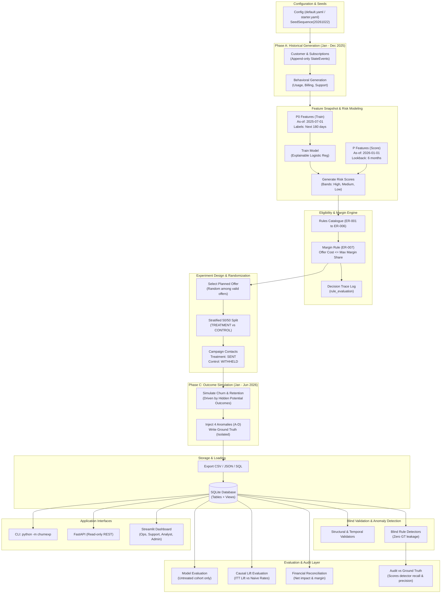

# Phase 2: Architecture Package

## 1. Architecture in One Picture

A modular Python monolith: one installable package (`churnexp`), one SQLite database, one CLI, one demo app. No microservices, no message queues.



---

## 2. The Key Design: How We Make the Data Honest

### ADR-004: Temporal Design (Leakage Defense)
- **Training snapshot $P_0 = \text{2025-07-01}$**: Features strictly use data from January to June 2025 (prior 6 months). Labels originate from the subsequent 180 days ($[2025-07-01, 2025-12-28]$). These training labels are fully known before the scoring date $P = \text{2026-01-01}$.
- **Scoring snapshot $P = \text{2026-01-01}$**: Features strictly use the 6 months preceding $P$ (July to December 2025). The model trained at $P_0$ is evaluated and scores accounts at $P$. No label or event occurring after $P$ is ever accessible to the feature builder or scoring pipeline.
- **Strict Validity Rule**: A feature event row is valid if and only if $\text{event\_date} < \text{as\_of\_date}$. Monthly snapshots count if and only if $\text{period\_end} < \text{as\_of\_date}$.
- **Consistency**: Refines decisions D1 and D2: 6-month look-back windows, 12 months of historical observation before $P$.
- **Temporal Entity Keys**: Churn outcome IDs explicitly incorporate the cycle year: `CHURN-CUS-000001-2025` (training cycle) and `CHURN-CUS-000001-2026` (scoring cycle).

### ADR-005: Hidden Potential Outcomes
- The data generator assigns each customer an underlying latent segment:
  - **Persuadable**: Retained if and only if treated with an attractive offer.
  - **Sure-thing**: Retained regardless of treatment.
  - **Lost-cause**: Churns regardless of treatment.
- Hidden counterfactuals (`churn_if_untreated`, `churn_if_treated`) are computed and stored exclusively in `ground_truth/`.
- Observed outcomes depend strictly on the actual randomized assignment. This establishes a ground-truth average treatment effect against which our causal lift estimators are audited.
- Pre-churn signals (usage decay, failed payments, escalation tickets) are generated from the latent churn driver, ensuring authentic predictive signal without trivial deterministic leakage.
- Seasonal subscribers exhibit low-usage months without churning, acting as realistic decoys.

### ADR-007: Experiment Design
- Eligible customers receive a **planned offer**, chosen uniformly at random among all candidate offers that satisfy the financial margin constraint (Rule ER-007).
- Following offer assignment, customers are randomized to **TREATMENT** or **CONTROL** (50/50 split, stratified across risk bands).
- Control group subjects receive a `CampaignContact` row with `contact_status = 'WITHHELD'` and preserve their assigned `offer_id`. This prevents selection bias and validates offer-level lift comparisons.
- **Primary Metric**: Intention-To-Treat (ITT) lift:
  $$\text{Lift}_{\text{ITT}} = \text{Retention}_{\text{Treatment}} - \text{Retention}_{\text{Control}}$$
  measured across all assigned customers, accompanied by analytical 95% confidence intervals.
- **Observational Comparison**: Naive "treated and stayed" and "redeemed and stayed" rates are computed side-by-side to highlight correlation versus true causation.

### ADR-012: Model Evaluation Cohort Isolation
- Post-experiment model performance (AUC-ROC, Brier score) is evaluated **strictly on untreated customers** (Control group, Untargeted low/medium risk customers, and Ineligible accounts).
- Customers who received an active treatment have their downstream churn probabilities altered by intervention; evaluating the baseline prediction model on treated customers would contaminate evaluation metrics.

---

## 3. Architecture Decision Records (ADRs)

| ADR | Problem | Decision | Trade-off |
| :--- | :--- | :--- | :--- |
| **001** | Architecture style | Modular monolith, single package `churnexp` | Less horizontally scalable across teams; significantly faster to build, test, and explain. |
| **002** | Where rules live | DB enforces relational structure (PK, FK, NOT NULL, enums, basic CHECK). Validators enforce business rules (temporal ordering, eligibility, group exclusivity, attribution). | Anomalies must load cleanly into SQLite to be detected; business rules cannot be rigid database CHECK constraints. |
| **003** | History tracking | Status is never an in-place mutable column. Plan changes instantiate new `Subscription` rows (`-02`) linked by `previous_subscription_id`. Transitions log to append-only `StateEvent`. | Current status is derived dynamically from events and views rather than scalar lookup. |
| **004** | Data leakage | Temporal snapshot design with $P_0$ (2025-07-01) and $P$ (2026-01-01), verified by mutate-the-future tests. | Requires dual-pass feature builder and strict temporal filtering logic. |
| **005** | Causal truth | Latent potential outcomes stored in `ground_truth/`. | Generator requires counterfactual modeling; provides definitive causal evaluation benchmark. |
| **006** | Ground truth separation | Isolated directory; no `issue_type` column in production tables. Detectors run blind; audit module scores performance. | Model, feature, and evaluation code are strictly prohibited from importing `audit` or reading `ground_truth/`. |
| **007** | Experiment structure | Planned offer first, then 50/50 stratified arm randomization, ITT primary metric. | Requires sufficient eligible pool size; preserves offer-level causal validity. |
| **008** | Determinism | Single master `SeedSequence(20261022)`, spawned into per-entity substreams keyed by customer index. Sorted output; no wall-clock timestamps. | Requires strict discipline in RNG handling and array sorting across steps. |
| **009** | Data in Git | Starter dataset (1,000 subscribers, all formats) committed to Git. Full 20k dataset generated via CLI; committed only if CSV total is comfortably under 50 MB, otherwise committed as starter + SHA-256 manifests. | Reviewer can inspect starter immediately; full data reproduces deterministically in seconds. |
| **010** | Predictive model | Explainable Logistic Regression with standardized features as primary; Gradient Boosting as optional secondary benchmark. | Marginally lower raw AUC compared to deep ensembles; delivers transparent coefficient interpretations and rapid training. |
| **011** | Serving architecture | FastAPI service is read-only. Streamlit calls shared domain services directly. | Eliminates unnecessary inter-process network hops in demo mode while preserving REST contracts. |
| **012** | Model evaluation purity | Model evaluation uses untreated cohorts only (control, untargeted, ineligible). | Reduces sample size for model evaluation; guarantees uncorrupted baseline metrics. |

---

## 4. Technology Stack (Final)

- **Language & Runtime**: Python 3.11
- **Data & Math**: NumPy, pandas, scikit-learn
- **Database**: SQLite 3 with plain SQL DDL (`schema.sql`, `views.sql`)
- **Configuration**: PyYAML (`config/default.yaml`, `config/starter.yaml`)
- **API & UI**: FastAPI, uvicorn, Streamlit, Plotly
- **Testing**: pytest (unit, integration, e2e)
- **Constraint Boundaries**: No Faker (avoids non-deterministic PII overhead), no ORM (explicit SQL schema), no Docker required (single local environment).

---

## 5. Entity Model (ERD)

```mermaid
erDiagram
    CUSTOMER ||--o{ SUBSCRIPTION : has
    SUBSCRIPTION ||--o{ SUBSCRIPTION : replaced_by
    SUBSCRIPTION ||--o{ USAGE_SNAPSHOT : produces
    SUBSCRIPTION ||--o{ BILLING_EVENT : bills
    CUSTOMER ||--o{ SUPPORT_CASE : raises
    SUBSCRIPTION ||--o{ SUPPORT_CASE : concerns
    CUSTOMER ||--o{ CAMPAIGN_CONTACT : receives
    OFFER ||--o{ CAMPAIGN_CONTACT : planned_for
    OFFER ||--o{ OFFER_ELIGIBILITY_RULE : specifies
    ELIGIBILITY_RULE ||--o{ OFFER_ELIGIBILITY_RULE : applies_to
    CAMPAIGN_CONTACT ||--o| RETENTION_OUTCOME : measured_by
    CUSTOMER ||--o{ CHURN_OUTCOME : labelled
    CUSTOMER ||--o{ RISK_SCORE : scored
    CUSTOMER ||--o{ FEATURE_SNAPSHOT : described_by
    CUSTOMER ||--o{ RULE_EVALUATION : evaluated_by
    OFFER ||--o{ RULE_EVALUATION : checked_in
    CUSTOMER ||--o{ STATE_EVENT : logs

    CUSTOMER {
        string customer_id PK "CUS-000001"
        date signup_date
        string segment "CONSUMER, SMB"
        string channel "ORGANIC, PAID, PARTNER, REFERRAL"
        string region
        string usage_pattern "STEADY, SEASONAL"
        boolean marketing_opt_in
    }

    SUBSCRIPTION {
        string subscription_id PK "SUB-CUS-000001-01"
        string customer_id FK
        string previous_subscription_id FK "nullable"
        integer sequence_no
        string plan_tier "BASIC, STANDARD, PREMIUM"
        real monthly_price
        real gross_margin_pct
        date start_date
        date end_date "nullable"
        string end_reason "PLAN_CHANGE, VOLUNTARY_CANCEL, INVOLUNTARY_CANCEL"
    }

    USAGE_SNAPSHOT {
        string snapshot_id PK "SNAP-SUB-CUS-000001-01-2025-06"
        string subscription_id FK
        string snapshot_month "YYYY-MM"
        date period_end
        integer active_days
        integer sessions
        real usage_minutes
        integer features_used
        real usage_pct_of_limit
    }

    BILLING_EVENT {
        string billing_event_id PK "BILL-SUB-01-202506-01"
        string subscription_id FK
        string related_event_id FK "nullable"
        string event_type "INVOICE, PAYMENT, PAYMENT_FAILED, RETRY, REFUND, CREDIT"
        date event_date
        date due_date
        real amount
        string status
        string failure_reason "nullable"
    }

    SUPPORT_CASE {
        string case_id PK "CASE-CUS-000001-0001"
        string customer_id FK
        string subscription_id FK
        timestamp opened_at
        timestamp resolved_at "nullable"
        string category "BILLING, TECHNICAL, CANCELLATION_INQUIRY, GENERAL"
        string severity "LOW, MEDIUM, HIGH, CRITICAL"
        boolean escalated
    }

    OFFER {
        string offer_id PK "OFF-2026-000001"
        string offer_name
        string offer_type "PERCENT_DISCOUNT, FREE_MONTH"
        real discount_pct
        integer free_months
        integer duration_months
        real max_cost_share_of_margin
        date valid_from
        date valid_to
    }

    ELIGIBILITY_RULE {
        string rule_id PK "ER-001"
        string rule_code
        string rule_type
        string parameter_json
        string version
        date effective_from
        date effective_to
    }

    OFFER_ELIGIBILITY_RULE {
        string offer_id PK,FK
        string rule_id PK,FK
    }

    CAMPAIGN_CONTACT {
        string contact_id PK "CMP-CUS-000001-2026-W01"
        string customer_id FK
        string offer_id FK
        string experiment_group "TREATMENT, CONTROL"
        string contact_status "SENT, WITHHELD, DELIVERY_FAILED"
        timestamp assigned_at
        timestamp sent_at "nullable"
        string stratum
        boolean responded
        boolean redeemed
    }

    CHURN_OUTCOME {
        string churn_id PK "CHURN-CUS-000001-2026"
        string customer_id FK
        integer cycle_year "2025, 2026"
        date prediction_date
        date horizon_end
        boolean churned
        date churn_date "nullable"
        string churn_type "VOLUNTARY, INVOLUNTARY, nullable"
    }

    RETENTION_OUTCOME {
        string retention_id PK "RET-CMP-CUS-000001-2026-W01"
        string contact_id FK
        string customer_id FK
        string attributed_offer_id FK "nullable"
        date window_start
        date window_end
        boolean retained
        date churned_at "nullable"
    }

    RISK_SCORE {
        string score_id PK "RS-CUS-000001-2026-01-01"
        string customer_id FK
        date as_of_date
        string model_version
        real score
        string band "HIGH, MEDIUM, LOW"
        integer rank
    }

    FEATURE_SNAPSHOT {
        string customer_id PK,FK
        date as_of_date PK
        date window_start
        date window_end
        real usage_ratio_3m_prior
        integer last_month_active_days
        real usage_slope_6m
        integer failed_payments_6m
        integer days_since_last_failure
        real outstanding_balance
        integer support_cases_6m
        integer high_severity_cases_6m
        integer cancellation_inquiries_6m
        integer tenure_days
        string plan_tier
        real monthly_price
        boolean plan_downgraded_6m
        string segment
        string channel
        string usage_pattern
    }

    RULE_EVALUATION {
        string evaluation_id PK "RE-CUS-000001-ER-001-2026-01-01"
        string customer_id FK
        string offer_id FK "nullable"
        string rule_id FK
        date as_of_date
        boolean passed
        string observed_value
        string threshold_value
    }

    STATE_EVENT {
        string event_id PK "EVT-000000001"
        string entity_type "SUBSCRIPTION, CAMPAIGN_CONTACT, CUSTOMER"
        string entity_id
        string from_state
        string to_state
        timestamp event_ts
        string reason_code
        string source
    }
```



---

## 6. Database Schema (Column Level)

| Table | Primary Key | Foreign Keys | Key Columns, Enums & Constraints |
| :--- | :--- | :--- | :--- |
| `customer` | `customer_id` (`CUS-000001`) | None | `signup_date`, `segment` (`CONSUMER`, `SMB`), `channel` (`ORGANIC`, `PAID`, `PARTNER`, `REFERRAL`), `region`, `usage_pattern` (`STEADY`, `SEASONAL`), `marketing_opt_in`. |
| `subscription` | `subscription_id` (`SUB-CUS-000001-01`) | `customer_id`, `previous_subscription_id` | `plan_tier` (`BASIC`, `STANDARD`, `PREMIUM`), `monthly_price`, `gross_margin_pct`, `start_date`, `end_date` (nullable), `end_reason` (`PLAN_CHANGE`, `VOLUNTARY_CANCEL`, `INVOLUNTARY_CANCEL`). `UNIQUE(customer_id, sequence_no)`. `CHECK(end_date IS NULL OR end_date >= start_date)`. |
| `usage_snapshot` | `snapshot_id` (`SNAP-<sub>-YYYY-MM`) | `subscription_id` | `snapshot_month` (`YYYY-MM`), `period_end`, `active_days`, `sessions`, `usage_minutes`, `features_used`, `usage_pct_of_limit`. `UNIQUE(subscription_id, snapshot_month)`. |
| `billing_event` | `billing_event_id` (`BILL-<sub>-YYYYMM-NN`) | `subscription_id`, `related_event_id` (self-ref) | `event_type` (`INVOICE`, `PAYMENT`, `PAYMENT_FAILED`, `RETRY`, `REFUND`, `CREDIT`), `event_date`, `due_date`, `amount`, `status`, `failure_reason`. |
| `support_case` | `case_id` (`CASE-<cus>-NNNN`) | `customer_id`, `subscription_id` | `opened_at`, `resolved_at` (nullable), `category` (`BILLING`, `TECHNICAL`, `CANCELLATION_INQUIRY`, `GENERAL`), `severity` (`LOW`, `MEDIUM`, `HIGH`, `CRITICAL`), `escalated`. |
| `offer` | `offer_id` (`OFF-2026-000001`) | None | `offer_type` (`PERCENT_DISCOUNT`, `FREE_MONTH`), `discount_pct`, `free_months`, `duration_months`, `max_cost_share_of_margin`, `valid_from`, `valid_to`. |
| `eligibility_rule`| `rule_id` (`ER-001`) | None | `rule_code`, `rule_type`, `parameter_json`, `version`, `effective_from`, `effective_to`. |
| `offer_eligibility_rule` | `(offer_id, rule_id)` | `offer_id`, `rule_id` | Resolves N:M relationship between offers and candidate rules. |
| `campaign_contact` | `contact_id` (`CMP-<cus>-2026-W01`) | `customer_id`, `offer_id` | `experiment_group` (`TREATMENT`, `CONTROL`), `contact_status` (`SENT`, `WITHHELD`, `DELIVERY_FAILED`), `assigned_at`, `sent_at` (nullable), `stratum`, `responded`, `redeemed`. `CHECK(contact_status != 'SENT' OR experiment_group = 'TREATMENT')`. |
| `churn_outcome` | `churn_id` (`CHURN-<cus>-YYYY`) | `customer_id` | `cycle_year`, `prediction_date`, `horizon_end`, `churned`, `churn_date` (nullable), `churn_type` (`VOLUNTARY`, `INVOLUNTARY`). `UNIQUE(customer_id, cycle_year)`. |
| `retention_outcome` | `retention_id` (`RET-<contact_id>`) | `contact_id`, `customer_id`, `attributed_offer_id` | `window_start`, `window_end`, `retained`, `churned_at` (nullable). `UNIQUE(contact_id)`. |
| `state_event` | `event_id` (`EVT-000000001`) | None (`entity_type` + `entity_id`) | `from_state`, `to_state`, `event_ts`, `reason_code`, `source`. Append-only. |
| `risk_score` | `score_id` (`RS-<cus>-<asof>`) | `customer_id` | `as_of_date`, `model_version`, `score`, `band` (`HIGH`, `MEDIUM`, `LOW`), `rank`. |
| `feature_snapshot`| `(customer_id, as_of_date)` | `customer_id` | `window_start`, `window_end`, and 16 engineered behavioral/contract features. |
| `rule_evaluation` | `evaluation_id` (`RE-...`) | `customer_id`, `offer_id`, `rule_id` | `as_of_date`, `passed`, `observed_value`, `threshold_value`. Full decision trace. |

### Business Rules Enforced by Application Validators (ADR-002)
1. **Temporal ordering**: Churn date must be on or after the prediction date ($P$ or $P_0$).
2. **Eligibility compliance**: Only customers passing ER-001 through ER-006 may be targeted.
3. **Group exclusivity**: Exactly one experiment group per assigned customer (no dual assignment).
4. **Attribution integrity**: At most one attribution per retained customer; attribution requires preceding campaign contact.
5. **Margin guardrail**: Realized offer cost must not exceed the allowed margin share.

---

## 7. Eligibility and Margin Engine

### Rule Catalogue
All rule parameters are stored external to code in `config/default.yaml` and evaluated strictly as of the assignment date ($P = \text{2026-01-01}$) using data dated before it.

| Rule Code | Rule Name | Evaluation Logic |
| :--- | :--- | :--- |
| **ER-001** | Active Subscription | Subscription is active at assignment date (`end_date IS NULL OR end_date > as_of_date`). |
| **ER-002** | Minimum Tenure | Customer tenure $\ge 90$ days (`as_of_date - signup_date >= 90`). |
| **ER-003** | Marketing Consent | `marketing_opt_in == True`. |
| **ER-004** | Clean Billing Balance | No unsettled failed payments in the look-back window (`outstanding_balance == 0.0`). |
| **ER-005** | No Critical Support Ticket | No open escalated support case (accounts with open escalations route to human support). |
| **ER-006** | High Risk Band | Model risk score $\ge$ configured threshold (e.g., top 20th percentile / High band). |
| **ER-007** | Financial Margin Cap | Calculated offer cost $\le \text{max\_cost\_share\_of\_margin} \times \text{expected 6-month gross margin}$. |

### Margin & Financial Calculations
- **Offer Cost Calculation**:
  - Discount Offer: $\text{Cost} = \text{discount\_pct} \times \text{monthly\_price} \times \text{duration\_months}$
  - Free Month Offer: $\text{Cost} = \text{free\_months} \times \text{monthly\_price}$
- **Expected Margin**:
  $$\text{Expected Margin}_{6m} = 6 \times \text{monthly\_price} \times \text{gross\_margin\_pct}$$
- **Realized Cost**: Counts only when a customer redeems the offer and remains retained.
- **Net Incremental Financial Impact**:
  $$\text{Net Impact} = (\Delta \text{Retained Customers} \times \text{Average Remaining Margin}) - \text{Total Realized Offer Cost}$$

---

## 8. Engineered Features (Pre-as_of_date Observation Only)

All features are extracted strictly from events prior to `as_of_date`:

1. **Usage Features**:
   - `usage_ratio_3m_prior`: Ratio of active usage minutes in the last 3 months vs prior 3 months ($M_{-3..-1} / M_{-6..-4}$).
   - `last_month_active_days`: Days active in the most recent complete month.
   - `usage_slope_6m`: Linear regression slope of monthly usage minutes over the 6-month window.
2. **Billing Features**:
   - `failed_payments_6m`: Count of failed payment events in the last 6 months.
   - `days_since_last_failure`: Days elapsed since the most recent payment failure (imputed if none).
   - `outstanding_balance`: Current unresolved invoice balance.
3. **Support Features**:
   - `support_cases_6m`: Total support tickets opened in the last 6 months.
   - `high_severity_cases_6m`: High or critical tickets in the last 6 months.
   - `cancellation_inquiries_6m`: Support tickets categorized under cancellation inquiries.
4. **Contract & Demographic Features**:
   - `tenure_days`: Days elapsed since `signup_date`.
   - `plan_tier`: Ordinal/one-hot encoding of Basic, Standard, Premium.
   - `monthly_price`: Current monthly subscription fee.
   - `plan_downgraded_6m`: Boolean flag indicating a downgrade transition in the last 6 months.
   - `segment`: `CONSUMER` or `SMB`.
   - `channel`: Acquisition source.
   - `usage_pattern`: `STEADY` or `SEASONAL` (observable customer behavioral trait).

### Automated Leakage Defense Test
- **Test Definition**: Execute feature extraction at $P = \text{2026-01-01}$, producing feature matrix $M_1$. Mutate or delete all rows dated $\ge \text{2026-01-01}$ in the database, re-execute feature extraction to yield $M_2$, and assert:
  $$\text{assert\_frame\_equal}(M_1, M_2)$$

---

## 9. Application Interfaces

### CLI Interface
```bash
python -m churnexp [generate|validate|train|campaign|evaluate|audit|repro-check|all] --scale [starter|full]
```

### FastAPI Service (Read-Only REST)
- `GET /health`: System status, SQLite connectivity, row counts.
- `GET /customers/{id}`: Customer profile, subscription details, plan history.
- `GET /customers/{id}/timeline`: Chronological unified event timeline.
- `GET /customers/{id}/eligibility`: Rule evaluation trace (ER-001 through ER-007).
- `GET /campaign/summary`: Assignment counts, treatment vs control, offer breakdown.
- `GET /experiment/results`: ITT retention lift, naive comparison rates, 95% CI.
- `GET /model/metrics`: ROC-AUC, Brier score, confusion matrix (untreated cohort).
- `GET /validation/report`: Summary of structural and temporal data validation checks.
- `GET /anomalies/detected`: Output of blind anomaly detectors.

### Streamlit Multi-Page UI
1. **Marketing Ops**: Campaign configuration, eligible customer explorer, group assignment balance, budget and margin impact.
2. **Support Agent**: Customer 360 view, unified chronological event timeline, real-time eligibility rule trace explanation.
3. **Data Analyst**: Churn model performance, ROC curves, feature importance, causal ITT lift vs naive observational metrics, anomaly detections.
4. **Platform Admin**: System health, database validation summary, reproducibility verification, checksum manifests.

---

## 10. Project Structure

```
churn-retention-experiment/
  pyproject.toml
  requirements.txt
  Makefile
  README.md
  config/
    default.yaml
    starter.yaml
  docs/
    01_requirements_spec.md
    02_architecture.md
    decisions.md
    TIMELINE.md
    data_dictionary.md
    test_report.md
  src/churnexp/
    __init__.py
    config.py
    ids.py
    rng.py
    cli.py
    schema/
      schema.sql
      views.sql
    generation/
      __init__.py
      customers.py
      subscriptions.py
      behavior.py
      usage.py
      billing.py
      support.py
      churn.py
      campaign_sim.py
      anomalies.py
      ground_truth.py
      orchestrator.py
    features/
      __init__.py
      builder.py
    modeling/
      __init__.py
      train.py
      score.py
      metrics.py
    eligibility/
      __init__.py
      rules.py
      engine.py
    experiment/
      __init__.py
      assign.py
    evaluation/
      __init__.py
      lift.py
      financial.py
      report.py
    validation/
      __init__.py
      structural.py
      temporal.py
      business.py
      detectors.py
      report.py
    audit/
      __init__.py
      ground_truth_scoring.py    # Only module permitted to read ground_truth/
    io/
      __init__.py
      exporters.py
      db_loader.py
      manifest.py
    services/
      __init__.py
      queries.py
    api/
      __init__.py
      main.py
  app/
    streamlit_app.py
  tests/
    unit/
    integration/
    e2e/
  data/
    starter/                     # Committed to Git (1,000 subscribers)
    full/                        # Generated via CLI (20,000 subscribers)
  ai-usage/
    README.md
    prompts/
      000_README.md
      001_claude_phase1_scaffolding.md
      002_claude_phase2_architecture_package.md
      003_antigravity_phase2_approval_and_docs.md
```

---

## 11. Testing Strategy

| Layer | Target Scope | Verification Method |
| :--- | :--- | :--- |
| **Unit** | ID formatting, RNG repeatability, individual eligibility rules (ER-001 - ER-007 pass/fail/boundary), margin calculations, causal lift formulas. | Deterministic pytest test cases. |
| **Data Integrity** | Primary key uniqueness, foreign key validity, enum values, sequential date checks, subscription continuity. | Automated SQLite validation suite. |
| **Leakage Defense** | Mutate-the-future assertions; architectural static check ensuring `churnexp.modeling`, `features`, and `evaluation` never import `audit` or access `ground_truth/`. | Pytest suite + AST import linter. |
| **Experiment Integrity** | Randomization balance across covariates (tenure, tier, risk score), exact 50/50 allocation within strata, correct ITT denominators. | Chi-squared and t-test covariate balance tests. |
| **Anomaly Detection** | Blind detection of Anomalies A through D with 100% target recall; audited precision reported against ground truth. | End-to-end blind detector benchmark. |
| **Reproducibility** | Full pipeline executed twice with seed `20261022`; SHA-256 hashes of generated data and row counts must match identically. | CLI `repro-check` test. |
| **E2E Smoke** | Fresh environment installation, `all --scale starter`, FastAPI route probes, Streamlit startup test. | Integration test runner. |

---

## 12. Implementation Roadmap (Milestone Gating)

| M# | Milestone Name | Dependencies | Scheduled Window (IST) |
| :--- | :--- | :--- | :--- |
| **M1** | Foundation: Python 3.11 env, skeleton, config, IDs, RNG, health check | None | Wed morning |
| **M2** | Schema DDL, SQL views, Data Dictionary | M1 | Wed morning |
| **M3** | History Generator: customers to churn outcomes | M2 | Wed midday |
| **M4** | Structural/temporal validators, exporters, reproducibility check | M3 | Wed afternoon |
| **M5** | Features and Risk Model ($P_0$ train, $P$ score) | M4 | Wed evening |
| **M6** | Eligibility and Margin Engine, rule trace logger | M5 | Wed night |
| **M7** | Randomized Assignment and outcome simulation | M6 | Thu morning |
| **M8** | Anomaly injection, ground truth isolation, blind detectors, audit scoring | M7 | Thu midday |
| **M9** | Evaluation Suite: model metrics, ITT lift, financial impact | M8 | Thu afternoon |
| **M10** | FastAPI service and Streamlit actor dashboard | M9 | Thu evening |
| **M11** | End-to-end QA, boundary validation, defect remediation | M10 | Thu night |
| **M12** | Documentation, clean-clone verification, final delivery packaging | M11 | by Thu 23:00 |

### Contingency Cut Order
If delivery timelines slip, features will be trimmed in the following strict order:
1. Plotly interactive chart animations in Streamlit (fallback to static charts).
2. Gradient boosting benchmark comparison (retaining primary explainable Logistic Regression).
3. Offer-level secondary lift breakdowns (retaining primary program-level ITT lift).
4. Secondary API query filter parameters.
*Strict Invariants (Never Cut)*: Leakage verification tests, blind anomaly detection, determinism/reproducibility, ground-truth isolation, AI usage transparency.

---

## 13. Owner Approval Record

- **Architecture Approval**: Approved without architectural modifications.
  - **ADR-004 Confirmed**: Dual-snapshot temporal structure ($P_0 = \text{2025-07-01}$, $P = \text{2026-01-01}$) with zero leakage is adopted as the foundational integrity defense.
  - **ADR-007 Confirmed**: Planned-offer selection prior to 50/50 stratified randomization and ITT evaluation with `WITHHELD` control contacts is approved.
- **ADR-009 Confirmed**: Starter dataset (1,000 subscribers) will be committed directly in repository; full 20,000 subscriber dataset will be generated deterministically and committed only if CSV total remains comfortably under 50 MB, otherwise verified via committed cryptographic SHA-256 manifests.

## Addendum: Schema refinements (M2)

- Restored `discount_pct` to nullable with proper CHECK constraints distinguishing percent vs free-month offers.
- Enforced ID format GLOB patterns for all entities (e.g., `OFF-YYYY-######`).
- Documented enum values and lifecycle state transitions.
- Added notes on business rules not enforced at DB level (refer to data dictionary).
- Updated documentation of anomaly shapes A–D and ground‑truth schemas.

## Addendum: Generator (M3)

- **Parameterization**: All synthetic history generator parameters live in `config/default.yaml` under `generator:` and are validated by `churnexp.config.validate_config`.
- **Enum values where dictionary specifies `Any`**:
  - `customer.region`: `NA`, `EU`, `APAC`, `LATAM`.
  - `billing_event.status`: `POSTED` (invoices), `SETTLED` (payments and recovered retries), `FAILED` (failed payments and failed involuntary-churn retries).
  - `billing_event.failure_reason`: `INSUFFICIENT_FUNDS`, `EXPIRED_CARD`, `DO_NOT_HONOR`, `NETWORK_ERROR`.
  - `latent.hidden_segment`: `PERSUADABLE`, `SURE_THING`, `LOST_CAUSE`, `SLEEPING_DOG`.
- **Usage formulas**:
  - `usage_pct_of_limit = round(min(1.0, usage_minutes / plan_limit_minutes), 4)`
  - `active_days = 0 if usage_minutes == 0 else clip(round(20 * usage_minutes / customer_expected_minutes), 1, days_in_month)`
  - `sessions = max(active_days, round((usage_minutes / 22) * monthly_noise))`
  - `features_used = clip(round(1 + 6 * usage_pct_of_limit + feat_noise), 1, 8)`
  - `World.tables["usage_snapshot"]` retains `features_used` and `usage_pct_of_limit` in memory, while `load_world` projects to the columns defined in `schema.sql`.
- **State Events**: `state_event` records transitions for `CUSTOMER` (`INIT -> ACTIVE -> CHURNED`) and `SUBSCRIPTION` (`INIT -> ACTIVE -> EXPIRED | CANCELLED`) per the `entity_type` `CHECK` constraint in `schema.sql`.


